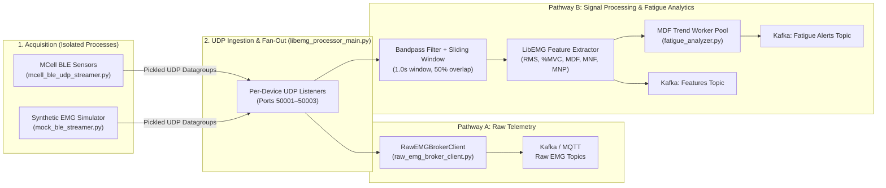

# Real-Time EMG Analysis & Dual-Stream Data Pipeline (Exoskeleton)

[](https://github.com/roshanmgupta/Exoskeleton/actions/workflows/ci.yml)


A multi-process, multi-threaded Python streaming pipeline for **real-time Electromyography (EMG) acquisition, signal processing, muscle fatigue detection, and dual-broker telemetry streaming** (Apache Kafka & MQTT), built for intelligent exoskeleton assistance during overhead tasks.

The pipeline runs two concurrent data pathways:

1. **Raw EMG Stream**: Publishes low-latency raw multi-channel sensor samples to **Kafka or MQTT** for logging, replay, or downstream consumers.
2. **Processed Feature & Fatigue Stream**: Applies bandpass filtering and sliding-window feature extraction (`RMS`, `%MVC`, `MDF`, `MNF`, `MNP`) via `libemg`, performs linear-regression fatigue trend detection on Median Frequency (MDF), and emits structured fatigue alerts to **Apache Kafka**.

---

## Architecture



---

## Key Features

- **Dual Concurrent Data Streams**: Simultaneously streams raw EMG samples (Kafka or MQTT) and processed features / fatigue alerts (Kafka).
- **Hardware-Free Simulation Mode (`--mock`)**: Includes a synthetic multi-channel EMG UDP generator (`mock_ble_streamer.py`) with realistic downward MDF spectral shift so anyone can test and demo fatigue detection without physical BLE hardware.
- **One-Command Local Brokers**: Ships with a KRaft-mode Apache Kafka + Mosquitto MQTT `docker-compose.yml`.
- **Multi-Device Isolation**: Spawns an isolated process per wireless EMG unit (`Shirt01-Left`, `Shirt01-Right`, `Shirt01-Trunk`) feeding dedicated processor threads over localhost UDP.
- **MVC Normalization & Fatigue Triage**: Includes an interactive MVC calibration utility (`mvc_calibration_tool_live.py`) for `%MVC` normalization and a thread-pooled MDF linear-regression detector (`slope` + `R²` thresholds with cooldown gating).
- **Environment-Driven Configuration**: All broker hosts, topics, BLE addresses, and thresholds are configurable via environment variables (see `.env.example`) and `config_live.py`.

---

## Quick Start

### 1. Clone & Install

```bash
git clone https://github.com/roshanmgupta/Exoskeleton.git
cd Exoskeleton
python -m venv venv
# Windows:
venv\Scripts\activate
# Linux / macOS:
source venv/bin/activate

pip install -r requirements.txt
```

### 2. Run Locally Without Hardware (Dry-Run Demo)

Test real-time synthetic EMG streaming, bandpass filtering, feature extraction, and fatigue alert detection with **zero external services or BLE hardware**:

```bash
python libemg_processor_main.py --mock --dry-run --duration 30
```

Add `--visualize` to open the real-time Matplotlib waveform & MDF plot window.

### 3. Run Full End-to-End Streaming Locally (Docker Kafka + MQTT)

Start local Kafka (`localhost:9092`) and Mosquitto MQTT (`localhost:1883`):

```bash
docker compose up -d
python libemg_processor_main.py --mock
```

To switch raw streaming to MQTT instead of Kafka:

```bash
RAW_BROKER_TYPE=mqtt python libemg_processor_main.py --mock
```

### 4. Run with Physical MCell BLE Hardware

1. Discover your sensor MAC addresses:
   ```bash
   python BleScan.py
   ```
2. Copy `.env.example` to `.env` (or export `BLE_ADDR_LEFT`, `BLE_ADDR_RIGHT`, `BLE_ADDR_TRUNK`, and `KAFKA_BROKERS`).
3. Perform one-time MVC calibration to generate `mvc_references.json`:
   ```bash
   python mvc_calibration_tool_live.py
   ```
4. Launch the live pipeline:
   ```bash
   python libemg_processor_main.py
   ```

Press `Ctrl+C` for graceful shutdown of all streamer processes, worker threads, and broker clients.

---

## Configuration

Key environment variables (defaults live in `config_live.py` and `.env.example`):

| Variable | Default | Description |
| :--- | :--- | :--- |
| `KAFKA_BROKERS` | `localhost:9092` | Comma-separated Kafka bootstrap servers |
| `RAW_BROKER_TYPE` | `kafka` | Raw EMG broker backend (`kafka` or `mqtt`) |
| `MQTT_HOST` / `MQTT_PORT` | `localhost` / `1883` | MQTT broker endpoint when `RAW_BROKER_TYPE=mqtt` |
| `PARTICIPANT_ID` | `demo-participant-01` | Identifier attached to feature payloads |
| `BLE_ADDR_LEFT` / `RIGHT` / `TRUNK` | `00:00:00:00:00:01..03` | Physical MCell BLE sensor addresses |
| `ENABLE_LIVE_VISUALIZATION` | `false` | Enable live Matplotlib plots (`true`/`false`) |

---

## Project Structure

```text
Exoskeleton/
├── libemg_processor_main.py      # Main orchestrator (UDP ingestion, LibEMG features, CLI flags)
├── mcell_ble_udp_streamer.py     # Isolated BLE acquisition & header-parsing UDP streamer
├── mock_ble_streamer.py          # Synthetic multi-channel EMG UDP streamer with fatigue ramp
├── fatigue_analyzer.py           # Linear-regression MDF fatigue detector & Kafka alerter
├── raw_emg_broker_client.py      # Broker-agnostic Kafka / MQTT publisher for raw EMG
├── mvc_calibration_tool_live.py  # Interactive MVC calibration utility
├── BleScan.py                    # BLE device discovery helper
├── config_live.py                # Centralized env-driven configuration
├── mvc_references.json           # Sample MVC reference values for %MVC normalization
├── docker-compose.yml            # Local Kafka (KRaft) + Mosquitto MQTT stack
├── docker/mosquitto.conf         # Local MQTT broker configuration
├── tests/test_pipeline.py        # Unit tests for fatigue analytics, mock streamer & config
├── .github/workflows/ci.yml      # Automated syntax & unit test workflow
├── .env.example                  # Environment variable template
└── requirements.txt              # Python dependencies
```

---

## Running Tests

```bash
python -m unittest discover -s tests -v
```
